>  📢 **Heads up:** My previous GitHub account (@ayushcmd) was suspended by GitHub’s abuse detection system, and some repositories were lost. Connect with me on my new account, [@ayushcmdx](https://github.com/ayushcmdx).

<h3><code>ayushcmdx@github ~ $ ./contributions.sh</code></h3>

  

<h3><code>ayushcmdx@github ~ $ whoami</code></h3>

<table align="center" border="0" cellpadding="0" cellspacing="0">
  <tr>
    <td valign="top" align="center">
      
    </td>
    <td width="20"></td>
    <td valign="top" align="center">
      
    </td>
  </tr>
</table>

  

<h3><code>ayushcmdx@github ~ $ ./links.sh</code></h3>

  <strong>Ayush Raj</strong> 
  Computer Science &amp; Data Analytics &nbsp;|&nbsp; Software Development • Cloud • DevOps

  
  &nbsp;
  
  &nbsp;
  

 

---

### About Me & Technical Skills

| Field | Details |
| :--- | :--- |
| **Name** | Ayush Raj |
| **College &amp; Degree** | Indian Institute of Technology (IIT) Patna — B.S. Computer Science &amp; Data Analytics (2024–2028) |
| **Core Interests** | Full-Stack Development • Cloud &amp; AWS • AI/ML/Python |
| **Connect** | [Portfolio](https://ayushcmd.me) &nbsp;•&nbsp; [GitHub](https://github.com/ayushcmdx) &nbsp;•&nbsp; [LinkedIn](https://www.linkedin.com/in/ayushcmd) |

 

<strong>Languages &amp; Web:</strong>

  
  
  
  
  
  
  

<strong>Frontend &amp; Backend:</strong>

  
  
  
  

<strong>AI &amp; Data Analytics:</strong>

  
  
  
  
  
  
  
  
  

<strong>Cloud &amp; AWS:</strong>

  
  
  
  
  
  
  

<strong>DevOps &amp; Monitoring:</strong>

  
  
  
  
  
  
  
  
  
  

<strong>Databases &amp; Tools:</strong>

  
  
  
  
  
  

 
